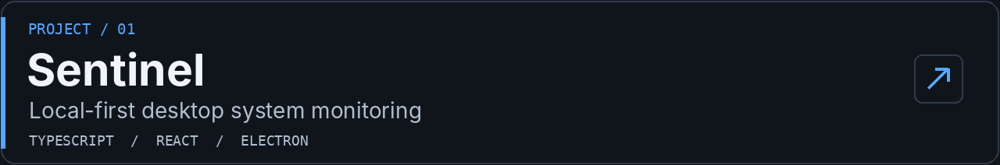
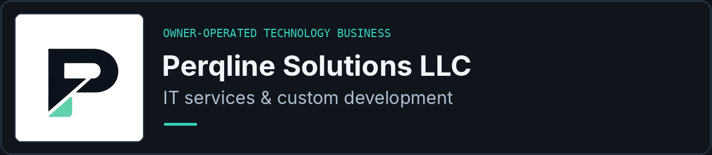
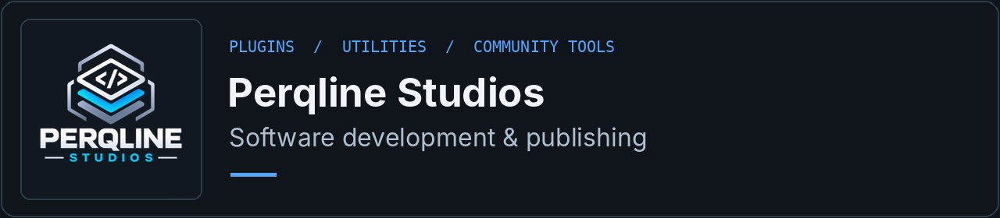
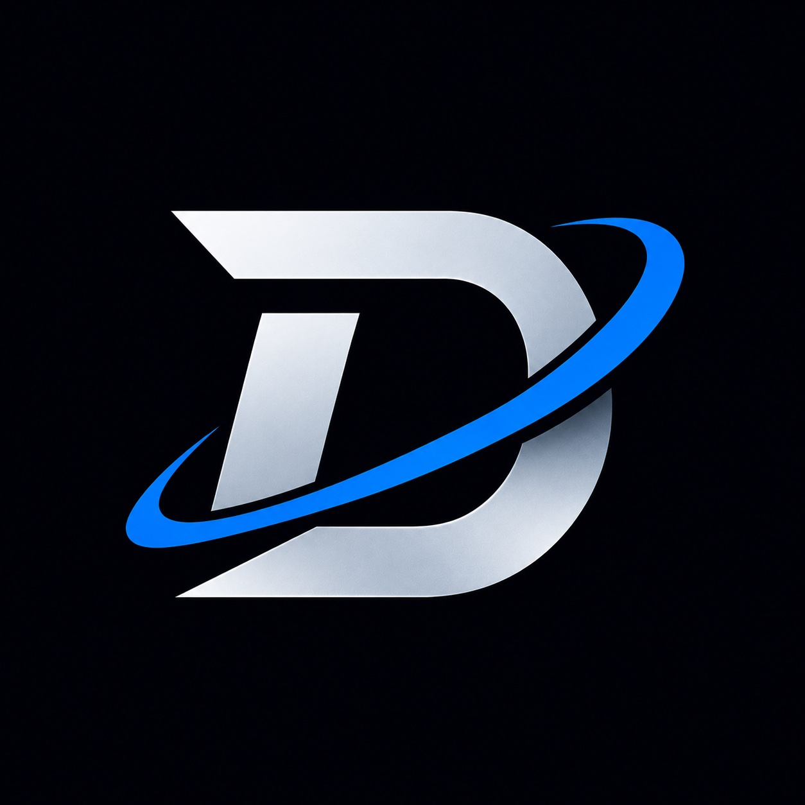

---

## About me

I'm an independent software developer and IT professional based in Arizona. I own and operate **Perqline Solutions LLC** and develop software under the **Perqline Studios** brand.

I enjoy building tools that solve problems I run into myself, whether that's monitoring a system, inspecting a codebase, automating a workflow or building something for a gaming community.

My work ranges from web and desktop applications to backend services, self-hosted infrastructure, Minecraft plugins and game development.

I'm currently working on making more of my development public, expanding my software portfolio and getting more involved in the open-source community.

---

## Featured projects

A local-first desktop system monitoring application for performance metrics, process management, hardware information, network connections and system diagnostics.

Built with TypeScript, React and Electron.

 

An early-stage developer CLI and local dashboard for exploring project structures, inspecting supported configurations and identifying project health findings.

Built with TypeScript and Node.js.

 

[View all public repositories →](https://github.com/Drippyz1?tab=repositories)

---

## Languages & technologies

Technologies I've worked with across personal and professional projects, at varying levels of experience.

### Programming languages

### Web & application development

### Databases & storage

### Infrastructure & operating systems

### Game development & community systems

### APIs & integrations

### Development tools & CI/CD

### Configuration & documentation

---

## Technical focus

<table>
<tr>
<td width="50%" valign="top">

### Software development

- Full-stack web applications
- Cross-platform desktop software
- Backend services and APIs
- Developer tools and CLI utilities
- Mobile application development
- Database systems
- Automated testing

</td>
<td width="50%" valign="top">

### Systems & infrastructure

- IT support and administration
- Networking and troubleshooting
- Self-hosted infrastructure
- System monitoring and diagnostics
- Hardware and computer systems
- Containerization
- Defensive security tooling

</td>
</tr>
<tr>
<td width="50%" valign="top">

### Gaming & communities

- Minecraft plugin development
- Game development
- Discord applications
- Community management systems
- Custom server utilities
- Gaming-related software

</td>
<td width="50%" valign="top">

### Automation & integrations

- Workflow automation
- Third-party API integrations
- Webhooks and event-driven systems
- Software release management
- Business technology solutions
- Payment integrations

</td>
</tr>
</table>

---

## Professional work

**Founder & Owner**

Perqline Solutions LLC is my independently owned technology services business, providing IT support, custom development and technology solutions for residential and business customers.

Areas of service include:

- Custom software and website development
- Residential and business IT support
- Networking and infrastructure
- Computer systems and hardware
- Technical troubleshooting and diagnostics
- Business technology and automation

 

**Software Development & Publishing**

Perqline Studios is my software publishing brand focused on Minecraft plugins, developer utilities, gaming-related software and community applications.

I'm building a catalog of independently maintained software products with an emphasis on usability, reliability and long-term development.

<b>Minecraft plugin roadmap</b>

 

| Product | Category |
| :--- | :--- |
| PackPulse | Minecraft server plugin |
| ReturnBrief | Minecraft server plugin |
| RecipeScope | Minecraft server plugin |
| FarmLens | Minecraft server plugin |
| ItemProof | Minecraft server plugin |

This roadmap includes planned and in-development products. Availability and licensing are determined individually for each project.

---

## Current development

- Maintaining and expanding my existing software projects.
- Developing the Perqline Studios product catalog.
- Building new developer tools and system utilities.
- Improving public repository documentation and testing.
- Making more of my independent development publicly available.
- Exploring opportunities to contribute to existing open-source projects.

---

## Open source & collaboration

I'm interested in working with other developers, contributing to useful software and building projects that people can benefit from.

I'm particularly interested in collaborating on developer tooling, system monitoring, infrastructure, automation, self-hosted software and Minecraft-related projects.

If you find a bug, have an improvement in mind or want to discuss a project, feel free to open an issue in the relevant repository.

Please review each project's license and contribution guidelines before submitting changes.

---

## Connect

| Channel | Information |
| :--- | :--- |
| Personal GitHub | [@Drippyz1](https://github.com/Drippyz1) |
| Business website | [perqline.com](https://perqline.com) |
| General inquiries | [contact@perqline.com](mailto:contact@perqline.com) |
| Technical support | [support@perqline.com](mailto:support@perqline.com) |
| Software issues | Individual repository issue trackers |

---

**DRIPPYZ**

Independent Software Developer · IT Professional · Founder

