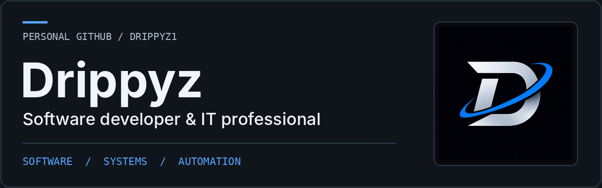
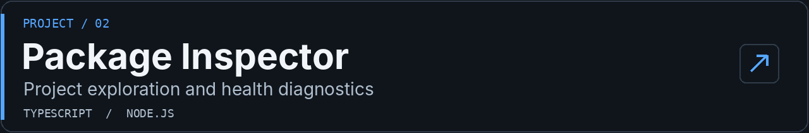

[Repositories](https://github.com/Drippyz1?tab=repositories) · [Website](https://perqline.com) · [Contact](mailto:contact@perqline.com)

## About me

I'm an independent software developer and IT professional based in Arizona. I run Perqline Solutions LLC and develop software under the Perqline Studios brand.

I like building tools that solve problems I run into myself, whether that's monitoring a system, inspecting a codebase, automating a workflow or building something for a gaming community. My work ranges from web and desktop applications to backend services, self-hosted infrastructure, plugins and games.

I'm making more of my work public and looking to contribute to projects in the ecosystems I use.

## Selected projects

A desktop system monitor for performance metrics, processes, hardware information, network connections and local diagnostics.

[Source code](https://github.com/Drippyz1/sentinel) · [Releases](https://github.com/Drippyz1/sentinel/releases) · [Dashboard screenshot](https://github.com/Drippyz1/sentinel/blob/main/docs/images/dashboard.png) · [Issues](https://github.com/Drippyz1/sentinel/issues)

An early-stage developer CLI and local dashboard for inspecting supported project configurations, exploring project structures and reporting project health findings.

[Source code](https://github.com/Drippyz1/package-inspector) · [Issues](https://github.com/Drippyz1/package-inspector/issues)

## Languages & tools

These are technologies I've worked with across personal and professional projects, at varying levels of experience.

| Area | Technologies |
| :--- | :--- |
| Programming & query languages | `TypeScript` `JavaScript` `Python` `Java` `Rust` `C++` `SQL` |
| Web & application development | `HTML` `CSS` `React` `Next.js` `Vite` `Node.js` `Electron` |
| Databases | `MongoDB` `MySQL` `PostgreSQL` `SQLite` |
| Infrastructure & operating systems | `Linux` `Ubuntu` `Docker` `macOS` `Windows` |
| Games & communities | `Godot` `PaperMC` `Minecraft APIs` `Discord.js` |
| APIs & integrations | `REST` `Webhooks` `Stripe` `GitHub API` `Discord API` |
| Development & delivery | `Git` `GitHub` `GitHub Actions` `VS Code` `Xcode` `npm` `pnpm` |
| Configuration & documentation | `JSON` `YAML` `Markdown` |

I also work with networking, self-hosted services, troubleshooting, system diagnostics, mobile development and software testing. I'm interested in defensive security and privacy-conscious design.

## Professional work

My independently owned technology services business, providing IT support, networking, custom software, web development and computer solutions for residential and business customers.

[perqline.com](https://perqline.com) · [Business inquiries](mailto:contact@perqline.com)

My software publishing brand for Minecraft plugins, developer utilities and gaming/community tools. The planned plugin lineup includes PackPulse, ReturnBrief, RecipeScope, FarmLens and ItemProof. Products have their own licensing and release arrangements.

## Open source & collaboration

I'm interested in contributing to developer tooling, infrastructure, system monitoring, self-hosted software and Minecraft-related projects. I welcome reproducible bug reports, feature ideas and technical discussion on my public repositories.

Check each project's license and contribution guidelines before submitting changes. For project-specific questions, please use the relevant issue tracker.
